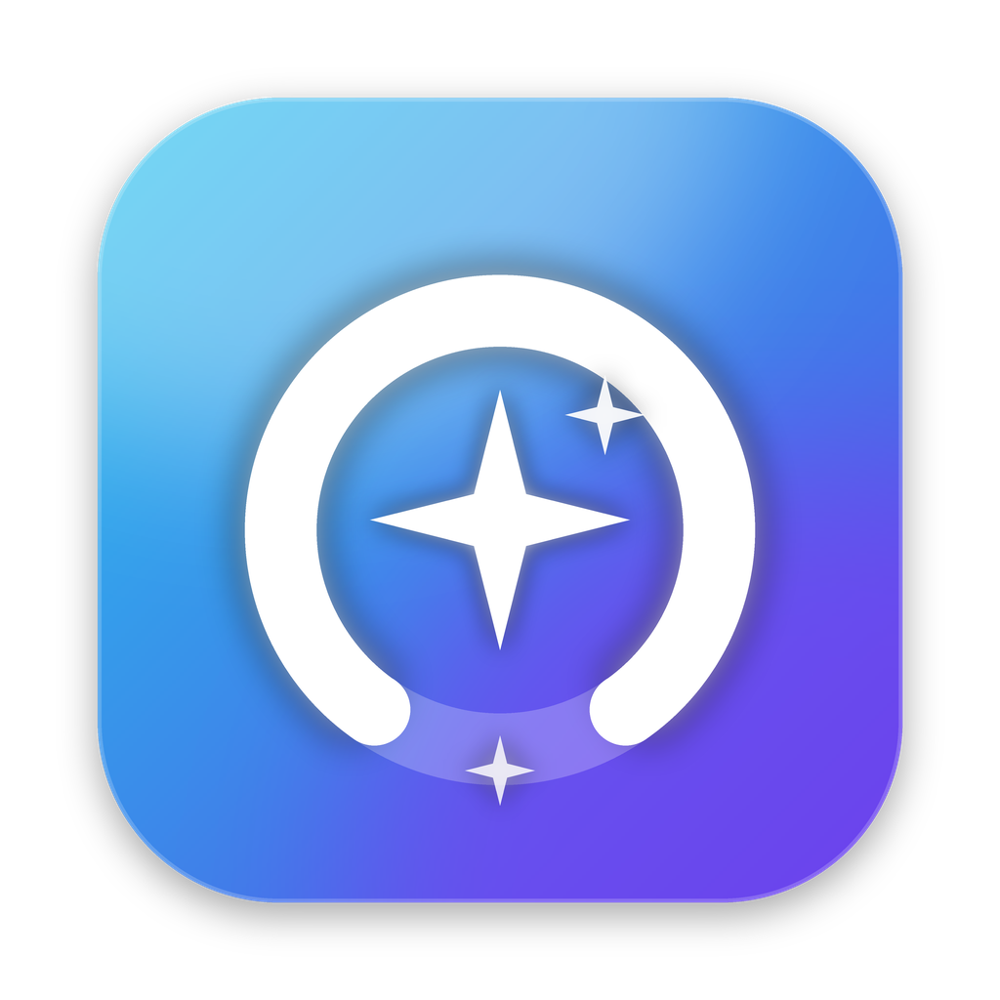

<p align="center"></p>

# SpaceSweep

**Find what is taking space. Clean only what is safe. Keep the files that matter.**

SpaceSweep is a native SwiftUI + AppKit storage cleaner for Apple silicon Macs. It's built for a developer Mac
with Xcode, Node.js, package-manager and browser caches. It scans a short, explicit allowlist of locations,
explains every item it finds, pre-selects only data that tools rebuild automatically, and reports honestly
what a cleanup did.

> Personal build, version 0.1.0. Not notarized. Keep a current backup of important files.

---

## What it cleans — and what it never touches

Every candidate is placed in one tier:

| Tier | Meaning | Selected by default | In One-click Safe Clean |
|---|---|---|---|
| **Safe** | Known, rebuildable data from an exact rule | Yes | Yes |
| **Review** | Possibly rebuildable, but may matter to you | No | **Never** |
| **Protected** | Shown for context only. No delete action exists | Not selectable | Never |
| **Blocked** | Temporarily unsafe: related app running, permission missing, changed since scan… | Not selectable | Never |

### Shipped rules

| Rule | Location | Tier | Notes |
|---|---|---|---|
| Xcode DerivedData | `~/Library/Developer/Xcode/DerivedData/*` | **Safe** | Blocked while Xcode is running. Next build/index is slower. |
| npm cache | `~/.npm/_cacache/*` | **Safe** | Same data as `npm cache clean --force`. Projects and `node_modules` are untouched. |
| Xcode Archives | `~/Library/Developer/Xcode/Archives/*` | Review | Archives may be your only copy of a shipped build and its dSYMs. |
| iOS / watchOS Device Support | `~/Library/Developer/Xcode/{iOS,watchOS} DeviceSupport/*` | Review | Re-copied from the device when needed. |
| SwiftUI Previews | `~/Library/Developer/Xcode/UserData/Previews/*` | Review | Needs Xcode and Simulator closed. |
| Simulator caches | `~/Library/Developer/CoreSimulator/Caches/*` | Review | Simulator *devices* are separate and protected. |
| Yarn cache | `~/Library/Caches/Yarn/*` | Review | |
| pnpm store | `~/Library/pnpm/store/*` | Review | Re-run `pnpm install` afterwards. |
| Homebrew downloads | `~/Library/Caches/Homebrew/downloads/*` | Review | Cellar, formulae, casks and `/opt/homebrew` are never touched. |
| CocoaPods, SwiftPM, pip, Go build caches | `~/Library/Caches/{CocoaPods,org.swift.swiftpm,pip,go-build}/*` | Review | |
| Chrome, Edge, Brave, Firefox caches | `~/Library/Caches/<browser>/*` | Review | Cache only. Profiles, cookies, history and passwords live elsewhere and are never touched. Blocked while the browser runs. |
| Other app caches | `~/Library/Caches/*` (one item per app folder) | Review | Apple caches (`com.apple.*`) and folders covered by a specific rule are excluded. Blocked while the owning app runs. |
| Old diagnostic reports | `~/Library/Logs/DiagnosticReports/*` older than 14 days | Review | |
| Trash | `~/.Trash/*` | Review | **Permanent.** Needs its own acknowledgement in the confirmation sheet, and is never part of one-click. |
| Simulator devices | `~/Library/Developer/CoreSimulator/Devices` | Protected | Size only. Manage them in Xcode or with `xcrun simctl delete unavailable`. |
| iPhone & iPad backups | `~/Library/Application Support/MobileSync/Backup` | Protected | Size only. Manage them in Finder › device › Manage Backups. |

**Never touched:** `/System`, `/Library`, `/usr`, `/bin`, `/sbin`, `/private`, `/var` (including swap in `/private/var/vm`),
`/Applications`, `/Volumes`, `/opt`, Time Machine and APFS snapshots, and macOS updates. In your home folder, SpaceSweep
never touches Documents, Desktop, Downloads, Pictures, Music, Movies, `.ssh`, `.gnupg`, `.aws`, `.config`, Keychains, Mail,
Messages, Photos, Safari, Cookies, Calendars, Contacts, Containers, iCloud Drive, browser profiles, or `.git`/`.svn`/`.hg`
data anywhere. It never deletes a rule's root folder itself, and never acts on anything the scan didn't find.

### Why it can't "delete System Data"

Apple's *System Data* is a reporting category, not one folder. It mixes logs, caches, temporary files, VM images,
app support data, local snapshots and more, each with different safety properties. SpaceSweep cleans only specific
targets it can explain. It doesn't promise to shrink the System Data figure. System Settings › Storage
updates its categories asynchronously and may take a while to change after a cleanup.

---

## Using it

1. Open SpaceSweep. **Overview** shows live capacity (from `URLResourceValues`) and when you last scanned.
2. Click **Scan Mac** (⌘R). The overlay shows real phases, items examined and bytes measured. **Cancel** (⌘.) stops it cleanly.
   Scanning never deletes anything.
3. Open **Scan Results** (⌘2). Safe items are pre-selected. Review items are listed but unselected. Protected and blocked items
   can't be selected. Click ⓘ on any group for *Why is this here?*, its exact location, and what cleaning will do.
4. Click **Clean Selected…** (⇧⌘↩). The confirmation sheet lists categories, estimated sizes, excluded Review items and
   consequences. Nothing is removed until you confirm.
5. The progress sheet shows each category. **Stop** stops new items from starting (the current item finishes safely).
6. The result sheet shows the **measured free-space change** separately from the **approximate bytes of files removed**,
   along with cleaned, skipped, failed and not-started counts and every problem in plain language.

**Developer Cleanup** (⌘3) shows the same scan as one card per tool, with live "Xcode is running" status and
quick *Include* switches.

**One-click Safe Clean** is off by default (Settings › Safety). When it's on, *and* you've confirmed at least one cleanup,
the Overview button scans and cleans the fixed **Safe** tier without a second confirmation. It never includes Review or
Protected items or the Trash, and SpaceSweep never cleans on a timer.

**Results expire.** A plan can only be built from a scan less than 10 minutes old, and results are cleared after each
cleanup and whenever you change rules.

### Inspecting a failed cleanup

Open **Activity** (⌘4). Every scan and cleanup records per-rule counts, approximate bytes, and the reason for each skipped
or failed item (for example *"Quit Xcode to clean this."*, *"The item changed since the scan."* or *"Permission denied."*).
The history is a JSON file at `~/Library/Application Support/SpaceSweep/activity.json`. Paths are **not** recorded
unless you turn on *Record paths in activity* in Settings. **Export…** writes a plain-text file, and includes paths only if
you tick *Include paths in diagnostic export*. **Clear History** removes only SpaceSweep's own log.

---

## Safety engineering

The deletion path is isolated in `SpaceSweepCore` and tested without a GUI.

- **Central typed registry** (`CleanupRuleRegistry`). Roots are home-relative path components, never concatenated strings.
- **`PathSafetyValidator`** runs when an item is discovered and again **immediately before** it is removed:
  - component-aware containment, so `/a/root-evil` is not inside `/a/root`
  - rejects `.`/`..` traversal, non-absolute and non-file URLs, the root itself, protected locations and their ancestors, and VCS folders
  - uses `lstat` so symbolic links are never followed, and compares `realpath` so the path cannot pass through a link
  - requires the item to be on the same volume as home and owned by the current user
  - checks a fingerprint (device, inode, type and APFS birth time), so an item swapped since the scan is rejected
- **Scanner** inspects only rule roots (never the whole disk), skips symlinks and other volumes, de-duplicates overlapping
  rules, runs off the main actor, throttles progress updates and supports cancellation.
- **Planner** builds plans only from fresh scans and only from selectable Safe/Review candidates whose tier still matches the
  rule. One-click plans contain Safe items only. A plan starts *pending confirmation*, and the executor refuses unconfirmed plans.
- **Executor** accepts only `PlannedTarget`s created by the planner (the UI cannot construct one from a path). Before each
  item it re-checks rule tier, root identity, running apps and the validator. It removes one item at a time with
  `FileManager.removeItem(at:)`. **No shell commands, no `rm -rf`, no `sudo`, no privileged helper, no admin password.**
  Failures are classified (permission, in use, disappeared, disk full…) and never counted as success. A partial removal
  reports only what actually disappeared.
- **Honest numbers:** estimated sizes (allocated size where available) are shown separately from the free-space change
  measured before and after cleanup. A zero or negative change shows as "unable to measure reliably", because APFS clones,
  compression, snapshots, purgeable space and other processes all move that number.

### Access model

SpaceSweep is a **non-sandboxed personal utility** with the hardened runtime. This lets it read rule folders in
`~/Library` with your normal user permissions. It respects TCC/SIP and never tries to bypass them. **Full Disk Access is
optional**: it only allows measuring privacy-protected locations (the Trash, device backups), and it never makes a protected
file deletable. When access is denied, the location appears under *Couldn't inspect* (never as junk), with a button to
System Settings › Privacy & Security › Full Disk Access. No network connections, telemetry, accounts, login items or
background services are used.

---

## Requirements

- macOS 14 Sonoma or later
- Apple silicon (arm64). The personal build targets M1 and later.
- Xcode 15.3+ or Xcode 16 (Swift 5.10+/6) to build

## Build, test and package

```bash
scripts/test.sh            # XCTest suite (65 tests, all on disposable fixture folders)
scripts/build-release.sh   # Release SpaceSweep.app for arm64 → dist/SpaceSweep.app
scripts/package-dmg.sh     # Creates and verifies dist/SpaceSweep-AppleSilicon.dmg + dist/build-info.txt
```

Outputs:

```text
dist/
├── SpaceSweep.app
├── SpaceSweep-AppleSilicon.dmg   # SpaceSweep.app + an Applications shortcut
└── build-info.txt                # version, arch, date, commit, signing status, sha256
```

Install by opening the DMG and dragging **SpaceSweep** onto **Applications**.

You can also open `Package.swift` in Xcode and run the **SpaceSweep** scheme for development, or run `swift run SpaceSweep`.
`python3 scripts/make_icon.py` regenerates the original icon (needs Pillow).

Every push also builds in GitHub Actions (`.github/workflows/build.yml`). That workflow runs the core tests on Linux as an
unprivileged user, and on macOS runs the tests, builds the arm64 app, packages and verifies the DMG, launch-tests the app,
and uploads the DMG as an artifact.

### Signing and notarization

- By default the app is **ad-hoc signed with the hardened runtime**. This is a personal build and it is **not notarized**.
  `build-info.txt` records the actual signing status.
- An app built on your own Mac runs normally there. A copy downloaded from elsewhere (for example the CI artifact) carries
  a quarantine flag, and Gatekeeper will warn because it isn't notarized. For the smoothest experience, build it yourself
  with the commands above.
- To distribute publicly, sign with a Developer ID (`SPACESWEEP_SIGN_IDENTITY="Developer ID Application: …" scripts/build-release.sh`)
  and notarize with `xcrun notarytool`. This needs an Apple Developer account. SpaceSweep doesn't claim to be notarized when it isn't.
- A DMG is a delivery container, not a guarantee that macOS will trust the app.

## Tests

`Tests/SpaceSweepCoreTests` covers the safety requirements, including:
valid targets accepted · root rejected · `..` traversal · similar-prefix siblings · symlink escapes (child, through-link, symlinked root
and ancestor) · protected paths (even when inserted manually) · unknown caches never Safe · Review never in one-click · blocked and
app-running targets not deleted · items disappearing or being swapped after the scan · overlapping rules not double-counted ·
permission errors (simulated and real) · cancellation for both scan and cleanup · estimates never reported as freed space ·
unavailable storage measurement · paths outside the plan rejected · every shipped rule's allowed and denied examples · activity
privacy. All destructive tests run inside a temporary fixture directory.

## Known limitations

- No CLI-process detection: SpaceSweep can't tell whether `npm install` is running (only app bundles are detected).
  Avoid cleaning the npm cache mid-install. npm's cache tolerates removal, but that install may fail.
- Folder sizes are allocated-size estimates. APFS clones and compression mean free space may change less than the estimate.
- Directory modification dates (used for the diagnostic-report age filter) reflect the folder itself, not its newest file.
- Docker Desktop images, simulator runtimes, and project `node_modules` folders are deliberately out of scope, with guidance in the app.
- The DMG uses a plain Finder layout (app and Applications shortcut) without a custom background.
